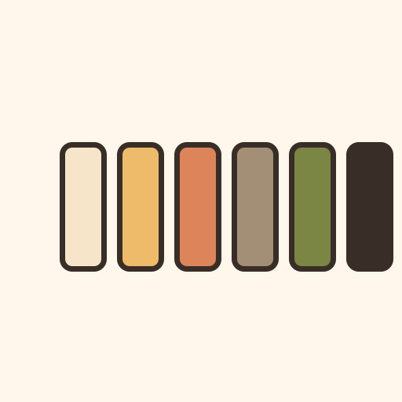

🎛️

# Gamme

**🎛️ One Material design system for kud's Android apps: shared rows, marks, motion and rules, each app's own colours.**

<a href="https://kud.io/projects/gamme">Website</a> · <a href="https://kud.io/projects/gamme/docs">Documentation</a>

## Features

The Material design system for kud's Android apps ([tutti](https://github.com/kud/tutti), [pastille](https://github.com/kud/pastille), and the ones to come).

- **Source-only kit** — each app copies it into its own `:design` module and compiles it with its own toolchain
- **Any toolchain** — apps on different Android Gradle Plugin and Kotlin versions can share it
- **Reproducible F-Droid builds** — everything builds from source
- **Shared foundations** — roles, shape, spacing and motion, plus the components that carry the accessibility rules
- **Each app's own colours** — colour schemes stay with each app

## Install

Gamme is not a dependency you pull in: an app copies the kit into its own `:design` module. The code arrives after pastille's first F-Droid release.

## Specification

- [`docs/spec.md`](docs/spec.md): the v0.1 specification, its rulings, and the rules drawn from reviewing the apps on a real phone.

## Licence

MIT

📚 **Full documentation → [gamme/docs](https://kud.io/projects/gamme/docs)**
