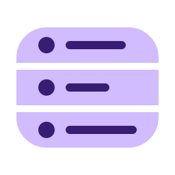

<div align="center">



# Gamme

**One Material design system for kud's Android apps: the same rows, marks, motion and rules, each app's own colours.** 🎛️

<a href="https://kud.io/projects/gamme">Website</a> · <a href="https://kud.io/projects/gamme/docs">Documentation</a>

</div>

Gamme is the design system behind [tutti](https://github.com/kud/tutti), [pastille](https://github.com/kud/pastille) and the apps to come. It is a source-only kit: each app copies it into its own `:design` module and compiles it with its own toolchain, so apps on different Android Gradle Plugin and Kotlin versions can share it, and F-Droid builds stay reproducible from source.

## Features

- **Roles, not colours** — each app keeps its own colour scheme; Gamme fixes what each Material role means (`primary` is on, `secondaryContainer` is selected, `inverseSurface` is the action, nothing else), and selection reads by lightness and shape, never hue.
- **Tokens** — shape, spacing and sizes, type with tabular figures, motion springs with a reduced-motion fallback, one haptic.
- **Seven components** — `GammeTheme`, `SettingsGroup`, `SettingsRow`, `SwitchRow`, `StateMark`, `EmptyState`, `SelectChip`, on Material3 1.3 so the oldest app can compile them.
- **Accessibility in the API** — a row can't be disabled without saying why, a switch row is one TalkBack target, selection never rests on colour alone, every target is 48 dp.
- **Rulings from real reviews** — the field notes from Erwann's reviews of both apps on a phone, written down as rules.

## Install

The Kotlin kit arrives after pastille's first F-Droid release. Each app will then copy it into its own `:design` module with a sync script that stamps the version, and a check that fails on drift. pastille adopts first, then tutti.

## Usage

```kotlin
GammeTheme(colors = GammeColors(lightColorScheme(), darkColorScheme())) {
    SettingsGroup(title = "Sync", glyphs = true) {
        SwitchRow(
            title = "Only on Wi-Fi",
            checked = wifiOnly,
            onCheckedChange = { wifiOnly = it },
            icon = painterResource(R.drawable.wifi),
        )
        SettingsRow(
            title = "Notify when done",
            unavailable = "Notifications are off for this app",
        )
    }
}
```

<!-- landing:skip -->

## Development

The docs live in [`docs/`](docs) as MDX, one page per foundation, component and ruling, ordered by `docs/meta.json`. The illustrations under `docs/illustrations/` are drawn from the spec's values by a script with no dependencies:

```console
$ node scripts/illustrations.mjs
15 illustrations in docs/illustrations/
```

MIT licensed. The glyphs come from Material Symbols (Apache 2.0, see [`NOTICE`](NOTICE)).

<!-- landing:/skip -->

📚 **Full documentation → [gamme/docs](https://kud.io/projects/gamme/docs)**
