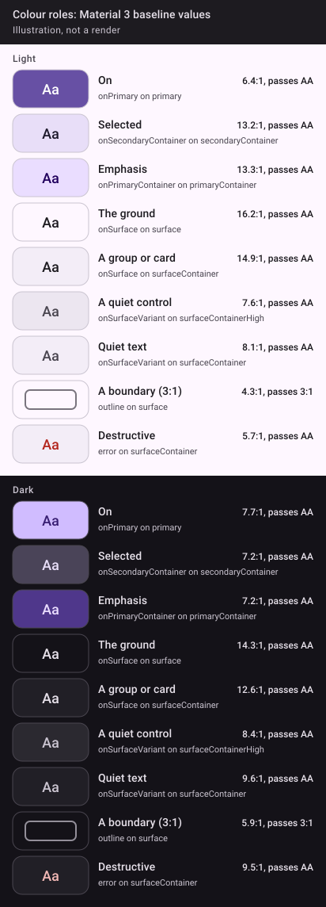

All in `app.beansontoast.design`. Values are exact; the comments say where each is used.

## 🎨 Colour roles (meanings; values per app)

| Role | Means | Rule |
| --- | --- | --- |
| `primary` / `onPrimary` | **On** | A switch's checked track, a toggle that is on, links. Never a selection, never a label colour. |
| `secondaryContainer` / `onSecondaryContainer` | **Selected** | A selected chip or segment, the extended FAB. Never decoration (no tiles behind glyphs). |
| `primaryContainer` | Emphasis, sparingly | The "Done" disc on top of its tick, a "Recommended" card. Never a selection. |
| `surface` = `background` | The ground | Screens and the 2 dp gap between grouped rows. |
| `surfaceContainer` | A group or card | Settings rows, list cards. |
| `surfaceContainerHigh` | A quiet control | An unselected chip, the empty-state disc. |
| `onSurface` | Text and icons on the ground | Provided as `LocalContentColor` at the theme root; group headings. |
| `onSurfaceVariant` | Quiet text and glyphs | Detail and reason lines, row glyphs, chevrons, marks at rest. |
| `outline` | A boundary that must read (3:1) | The dashed "not known" ring. |
| `error` | Destructive | Title and glyph of a destructive row only. A failure is the warning glyph and words, never red alone. |

Contrast floor, per app, light and dark: text 4.5:1, a state or boundary 3:1.

## 🖼️ The roles, at Material 3's baseline

Each app brings its own values (an app with no brand passes Material's baseline). Here are the baseline's, light and dark, with each pair's contrast checked against the floor above: the script that draws this fails if a pair falls under it.

