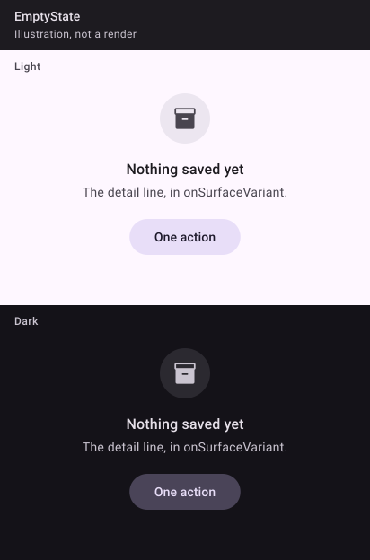

_Drawn from the spec's values with Material 3's baseline colours, light and dark. The Kotlin kit isn't written yet, so these are illustrations, not Compose renders; real renders replace them once it ships._

## 🧱 Signature

```kotlin
@Immutable
class GammeAction(val label: String, val onClick: () -> Unit)

@Composable
fun EmptyState(
    title: String,
    icon: Painter,
    modifier: Modifier = Modifier,
    detail: String? = null,
    action: GammeAction? = null,
)
```

## 📐 Rules

- A 56 dp `surfaceContainerHigh` disc with a 28 dp glyph in `onSurfaceVariant`; 16 dp; `title` in `titleMedium`, a heading; 4 dp; `detail` in `bodyMedium`, `onSurfaceVariant`; 20 dp; at most one `FilledTonalButton`. Centred, 32 dp side padding, 40 dp vertical (pastille's values).
- No action when the screen already has one (the FAB). Never shown before the data has loaded.
