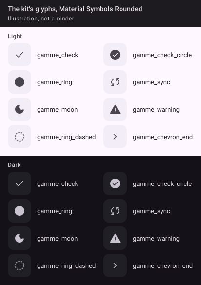

Vector drawables in the kit's `res/drawable`, prefixed `gamme_` (the app's `:design` build file sets `resourcePrefix = "gamme_"`), from Material Symbols Rounded, filled, at 24 dp viewports. Components take a `Painter`, so an app can pass `painterResource(R.drawable.x)` or, during migration, `rememberVectorPainter(Icons.Rounded.X)`.

| Drawable | Used by |
| --- | --- |
| `gamme_check` | Switch thumb; a selected chip with no glyph of its own |
| `gamme_check_circle` | Mark: Done |
| `gamme_ring` | Mark: Not yet |
| `gamme_sync` | Mark: On its way (never spins in v0.1) |
| `gamme_moon` | Mark: Resting |
| `gamme_warning` | Mark: Needs a look; every reason and notice line |
| `gamme_ring_dashed` | Mark: Not known (taken from tutti's own) |
| `gamme_chevron_end` | Row that opens something (`autoMirrored="true"`) |

Material Symbols are Apache 2.0: the kit keeps a `NOTICE` for them beside its MIT licence.

