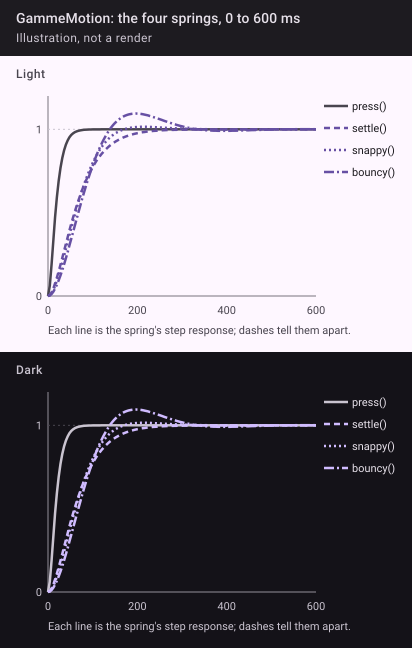

```kotlin
object GammeMotion {
    const val SHORT = 150        // a fade
    const val EXIT = 120         // the outgoing half of a transition, first
    const val MEDIUM = 250       // the ceiling for anything the user waits through
    const val REDUCED_OUT = 90   // reduced motion: outgoing fade
    const val REDUCED_IN = 120   // reduced motion: incoming fade (about 210 ms in all)

    val Emphasized = CubicBezierEasing(0.2f, 0f, 0f, 1f)
    val EmphasizedDecelerate = CubicBezierEasing(0.05f, 0.7f, 0.1f, 1f)
    val EmphasizedAccelerate = CubicBezierEasing(0.3f, 0f, 0.8f, 0.15f)

    /** A press landing (~65 ms, no overshoot). */
    fun <T> press(): SpringSpec<T> = spring(dampingRatio = 1f, stiffness = Spring.StiffnessHigh)
    /** Anything that moves the page: screens, rows, a chip's fill (~235 ms, no overshoot). */
    fun <T> settle(): SpringSpec<T> = spring(dampingRatio = 1f, stiffness = 800f)
    /** A control changing its own shape: a key, a tile turning on. Slight overshoot. */
    fun <T> snappy(): SpringSpec<T> = spring(dampingRatio = 0.8f, stiffness = 600f)
    /** At most once a screen: a success landing. */
    fun <T> bouncy(): SpringSpec<T> = spring(dampingRatio = 0.6f, stiffness = 400f)
}
```

Under reduced motion every movement becomes an opacity fade (`REDUCED_OUT` then `REDUCED_IN`), sizes snap, haptics stay.



## 📳 Haptics

One in v0.1, inside `SwitchRow`: **select** = `view.performHapticFeedback(HapticFeedbackConstants.VIRTUAL_KEY)` (tutti's mapping), which honours the system's touch-feedback setting. The rest of tutti's vocabulary (tick, bump, reject) joins the kit with the components that need it.
