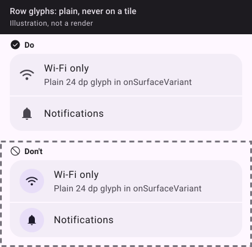
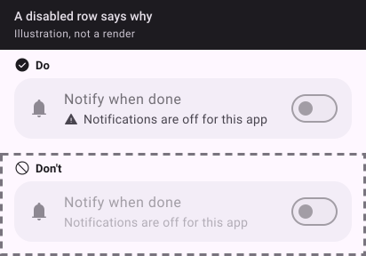

Three rules hold everywhere Gamme goes. Every component enforces them, and the [field notes](/projects/gamme/docs/field-notes) grew out of them.

- **No tiles behind glyphs.** A glyph is plain and monochrome; the selection colour is never decoration.
- **`primary` means on, `secondaryContainer` means selected**, and neither is borrowed for anything else (a label, a heading, a selected segment in `primaryContainer`).
- **Every disabled control says why**, in words at full contrast beside it; the API cannot express disabled without a reason. Read-only is not disabled.

## 🖼️ In practice

Contrast floor, per app, light and dark: text 4.5:1, a state or boundary 3:1. See [colour](/projects/gamme/docs/colour).
