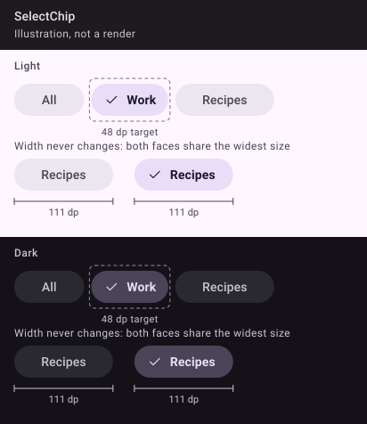
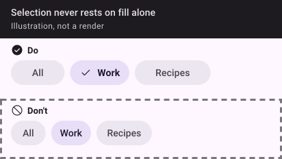

_Drawn from the spec's values with Material 3's baseline colours, light and dark. The Kotlin kit isn't written yet, so these are illustrations, not Compose renders; real renders replace them once it ships._

## 🧱 Signature

```kotlin
@Composable
fun SelectChip(
    selected: Boolean,
    onClick: () -> Unit,
    label: String,
    modifier: Modifier = Modifier,
    icon: Painter? = null,
    iconWhenUnselected: Boolean = false,
    role: Role = Role.Tab,
)
```

## 📐 Rules

- A pill (`CircleShape`), 36 dp tall in a 48 dp target (`minimumInteractiveComponentSize()`), 14 dp horizontal padding, `labelLarge`.
- Unselected: `surfaceContainerHigh`, `onSurfaceVariant` content, glyph only if `iconWhenUnselected`. Selected: `secondaryContainer`, `onSecondaryContainer`, glyph shown (`icon`, or `gamme_check` when there is none), SemiBold label.
- **Width never changes:** both faces are laid out on top of each other in one `Box`, the widest sets the size, and only their opacity moves (`settle`, a fade either way under reduced motion); the hidden face is `clearAndSetSemantics {}`.
- Semantics: `Modifier.selectable(selected, role = role, onClick = onClick)`; `Role.RadioButton` for a single choice in a form, `Role.Tab` (default) for a filter row over a list.

## 🙅 Do and don't


