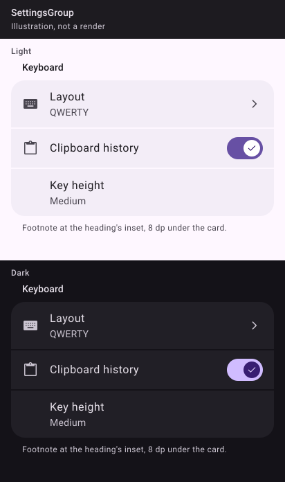

_Drawn from the spec's values with Material 3's baseline colours, light and dark. The Kotlin kit isn't written yet, so these are illustrations, not Compose renders; real renders replace them once it ships._

## 🧱 Signature

```kotlin
@Composable
fun SettingsGroup(
    title: String?,
    modifier: Modifier = Modifier,
    glyphs: Boolean = false,
    footnote: String? = null,
    content: @Composable ColumnScope.() -> Unit,
)
```

## 📐 Rules

- Heading: `titleSmall`, `onSurface`, `semantics { heading() }`, padded `start = 32.dp, end = 32.dp, top = 24.dp, bottom = 8.dp` (the group itself takes no margin; only the card is inset 16 dp), so it sits 32 dp from the screen edge.
- Card: `Column(Modifier.padding(horizontal = 16.dp).fillMaxWidth().clip(MaterialTheme.shapes.large), verticalArrangement = Arrangement.spacedBy(2.dp))`; nothing painted behind it.
- `glyphs = true` when any row in the group has a glyph: it provides the slot to every row so their text lines up at 56 dp.
- `footnote`: `bodySmall`, `onSurfaceVariant`, under the card at the heading's inset, 8 dp above.
