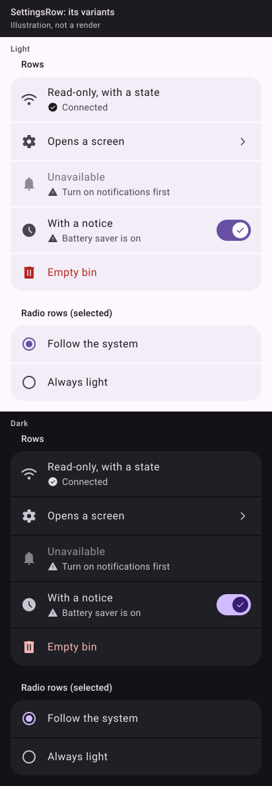

_Drawn from the spec's values with Material 3's baseline colours, light and dark. The Kotlin kit isn't written yet, so these are illustrations, not Compose renders; real renders replace them once it ships._

## 🧱 Signature

```kotlin
@Composable
fun SettingsRow(
    title: String,
    modifier: Modifier = Modifier,
    detail: String? = null,
    detailMinLines: Int = 1,
    detailMaxLines: Int = Int.MAX_VALUE,
    state: MarkState? = null,
    icon: Painter? = null,
    notice: String? = null,
    unavailable: String? = null,
    destructive: Boolean = false,
    selected: Boolean? = null,
    opens: Boolean = false,
    onClick: (() -> Unit)? = null,
    footer: (@Composable () -> Unit)? = null,
    trailing: (@Composable () -> Unit)? = null,
)
```

## 📐 Rules

- **Frame:** paints `surfaceContainer`, `heightIn(min = 56.dp)`, `padding(horizontal = 16.dp, vertical = 12.dp)`; leading slot 24 dp, 16 dp to the text; trailing 16 dp after it. The whole row is the one target.
- **Lines:** title `bodyLarge`; then exactly one of, in this order: `unavailable` (reason line), `notice` (reason line), `detail` (led by `StateMark(state)` when `state` is set). A reason line is `gamme_warning` at 16 dp + 6 dp + the words, `bodyMedium`, full `onSurfaceVariant`, never faded. `footer` goes under the lines.
- **Read-only** (`onClick == null && selected == null`): no `clickable`, no ripple, no chevron, full contrast; `semantics(mergeDescendants = true) {}` so TalkBack reads it as one.
- **Unavailable** (`unavailable != null`): the row is `clickable(enabled = false)`, so TalkBack says "disabled" and reads the reason with it; title and glyph at `GammeAlpha.DISABLED`. There is no `enabled` parameter: the reason is the switch.
- **Notice:** the setting is inactive for a reason outside the app; the row stays enabled and its control keeps the user's preference.
- **Destructive:** title and glyph in `error`. Its verb says what goes ("Empty bin").
- **Selected** (non-null): the row is a radio, `Modifier.selectable(selected, role = Role.RadioButton)`; the leading slot draws `RadioButton(selected, onClick = null)` (20 dp + 2 dp padding = the 24 dp slot). `icon` is ignored.
- **Opens:** draws `gamme_chevron_end` (24 dp, `onSurfaceVariant`) as the trailing control; only for a row that opens a screen, menu or system picker. Not combined with `trailing`.
- `onClick` rows get `Role.Button`.
- **One height across states** (Erwann, 2026-10-30, on pastille's Updates row, which jumped while checking): a row whose state changes in place (an updater, a sync, a connection) keeps its height. `detailMinLines` reserves the lines its longest state needs (2 for an updater), and every state's text fits them at 360 dp. Its `trailing` is one fixed-width box, sized to the widest single action, holding that state's `TextButton` or a centred 20 dp `CircularProgressIndicator` (indeterminate while waiting, determinate while it counts), never a greyed-out button: a button disabled for a moment is a disabled control with no reason. The detail is a polite live region, so TalkBack hears each state as it comes. The row may grow once, when there is something new to act on (pastille's Later and Download), never while it works.

## 🙅 Do and don't


