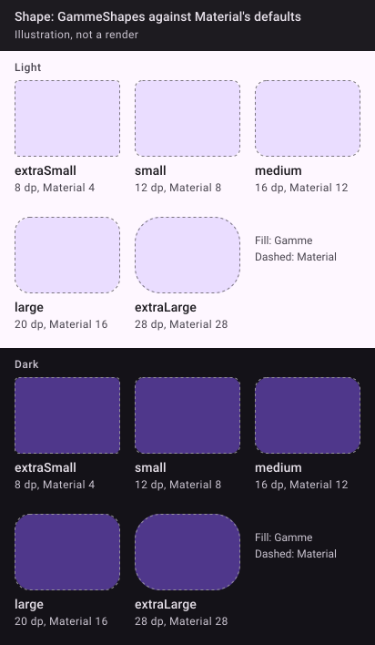

```kotlin
val GammeShapes = Shapes(
    extraSmall = RoundedCornerShape(8.dp),  // value tags, thumbnails; Material: text fields, menus
    small = RoundedCornerShape(12.dp),      // menus (the app's own), Material: assist/filter chips
    medium = RoundedCornerShape(16.dp),     // list cards, inner cards
    large = RoundedCornerShape(20.dp),      // settings groups (outer corners), Material: extended FAB
    extraLarge = RoundedCornerShape(28.dp), // sheets' top corners, dialogs (Material's own)
)
```

Material's defaults are 4 / 8 / 12 / 16 / 28: adopting the theme changes the corners of every stock Material component that reads them (listed per app in [Adoption](/projects/gamme/docs/adoption)).


