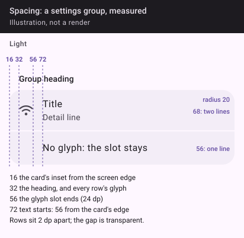

```kotlin
object GammeSpace {
    val hair = 2.dp   // between rows in a group
    val xs = 4.dp     // title to its detail line
    val s = 8.dp      // heading to its group; between chips; between list cards
    val m = 12.dp     // row vertical padding
    val l = 16.dp     // page margin; row horizontal padding; glyph to text
    val xl = 24.dp    // above a group heading
    val xxl = 32.dp   // empty state's side padding
}

object GammeSize {
    val target = 48.dp        // every touch target, whatever the visual
    val rowMin = 56.dp        // a settings row's minimum height
    val rowGlyph = 24.dp      // a row's leading glyph and its slot
    val rowInset = 56.dp      // row text from the card edge when the group has glyphs (16 + 24 + 16)
    val headingInset = 32.dp  // a group heading from the screen edge
    val mark = 16.dp          // a state mark, and the warning glyph of a reason line
    val markGap = 6.dp        // mark to its words
    val chipHeight = 36.dp    // visual; the target stays 48
    val chipGlyph = 18.dp
    val chipPadding = 14.dp   // horizontal, inside a chip
    val emptyDisc = 56.dp
    val emptyGlyph = 28.dp
}

object GammeAlpha {
    const val DISABLED = 0.6f // title and glyph of an unavailable row; never the reason line
}
```


