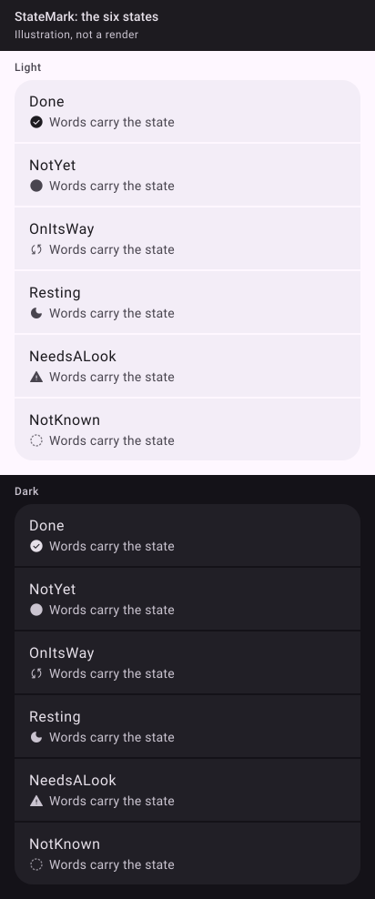

_Drawn from the spec's values with Material 3's baseline colours, light and dark. The Kotlin kit isn't written yet, so these are illustrations, not Compose renders; real renders replace them once it ships._

## 🧱 Signature

```kotlin
enum class MarkState { Done, NotYet, OnItsWay, Resting, NeedsALook, NotKnown }

@Composable
fun StateMark(state: MarkState, modifier: Modifier = Modifier)
```

## 📐 Rules

| State | Glyph | Tint |
| --- | --- | --- |
| `Done` | `gamme_check_circle` | `onSurface` |
| `NotYet` | `gamme_ring` | `onSurfaceVariant` |
| `OnItsWay` | `gamme_sync` | `onSurfaceVariant` |
| `Resting` | `gamme_moon` | `onSurfaceVariant` |
| `NeedsALook` | `gamme_warning` | `onSurfaceVariant` |
| `NotKnown` | `gamme_ring_dashed` | `outline` |

16 dp, decorative (`contentDescription = null`); the words beside it carry the state. All six ship in v0.1 although pastille needs three: a state vocabulary split between the kit and an app is the drift the sync check can't see.
