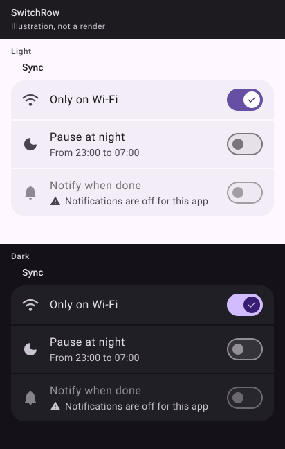

_Drawn from the spec's values with Material 3's baseline colours, light and dark. The Kotlin kit isn't written yet, so these are illustrations, not Compose renders; real renders replace them once it ships._

## 🧱 Signature

```kotlin
@Composable
fun SwitchRow(
    title: String,
    checked: Boolean,
    onCheckedChange: (Boolean) -> Unit,
    modifier: Modifier = Modifier,
    detail: String? = null,
    state: MarkState? = null,
    icon: Painter? = null,
    notice: String? = null,
    unavailable: String? = null,
    footer: (@Composable () -> Unit)? = null,
)
```

## 📐 Rules

- The row is the only target: `Modifier.toggleable(value = checked, enabled = unavailable == null, role = Role.Switch)`, which plays the **select** haptic, then calls `onCheckedChange`.
- The switch draws state only: `Switch(checked, onCheckedChange = null, enabled = unavailable == null, thumbContent = gamme_check when checked)`. With `onCheckedChange = null` it takes no clicks and is not a second TalkBack target (the bug in tutti's `SwitchRow` today).
- Same lines, reason and fade rules as `SettingsRow`; the switch is not faded by the row (Material's disabled colours are its one fade).
