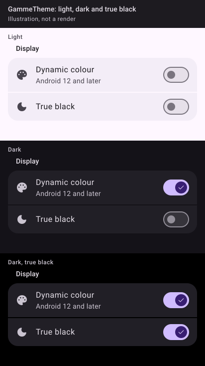

_Drawn from the spec's values with Material 3's baseline colours, light and dark. The Kotlin kit isn't written yet, so these are illustrations, not Compose renders; real renders replace them once it ships._

## 🧱 Signature

```kotlin
@Immutable
class GammeColors(val light: ColorScheme, val dark: ColorScheme)

val LocalReducedMotion = compositionLocalOf { false }

@Composable
fun GammeTheme(
    colors: GammeColors,
    darkTheme: Boolean = isSystemInDarkTheme(),
    dynamicColor: Boolean = false,
    trueBlack: Boolean = false,
    content: @Composable () -> Unit,
)

/** True while the system's animator duration scale is 0, read live. */
@Composable
fun rememberReducedMotion(): Boolean
```

## 📐 Rules

- Scheme: `dynamicLightColorScheme` / `dynamicDarkColorScheme` when `dynamicColor && Build.VERSION.SDK_INT >= Build.VERSION_CODES.S`, else the app's `colors`. An app with no brand passes Material's baseline (`lightColorScheme()`, `darkColorScheme()`), never system defaults.
- `trueBlack` applies in dark only: `background` and `surface` become `Color.Black`; containers keep their steps.
- `MaterialTheme(colorScheme, shapes = GammeShapes, typography = gammeTypography())`, then provides `LocalContentColor` = `colorScheme.onSurface` (pastille's fix: untinted icons outside a `Surface` were black on dark) and `LocalReducedMotion` = `rememberReducedMotion()`.
- `rememberReducedMotion` registers a `ContentObserver` on `Settings.Global.getUriFor(ANIMATOR_DURATION_SCALE)` in a `DisposableEffect` and unregisters on dispose (tutti's behaviour), so the setting takes effect without a restart.
- Window background, true-black persistence and the in-app theme choice stay in each app.
